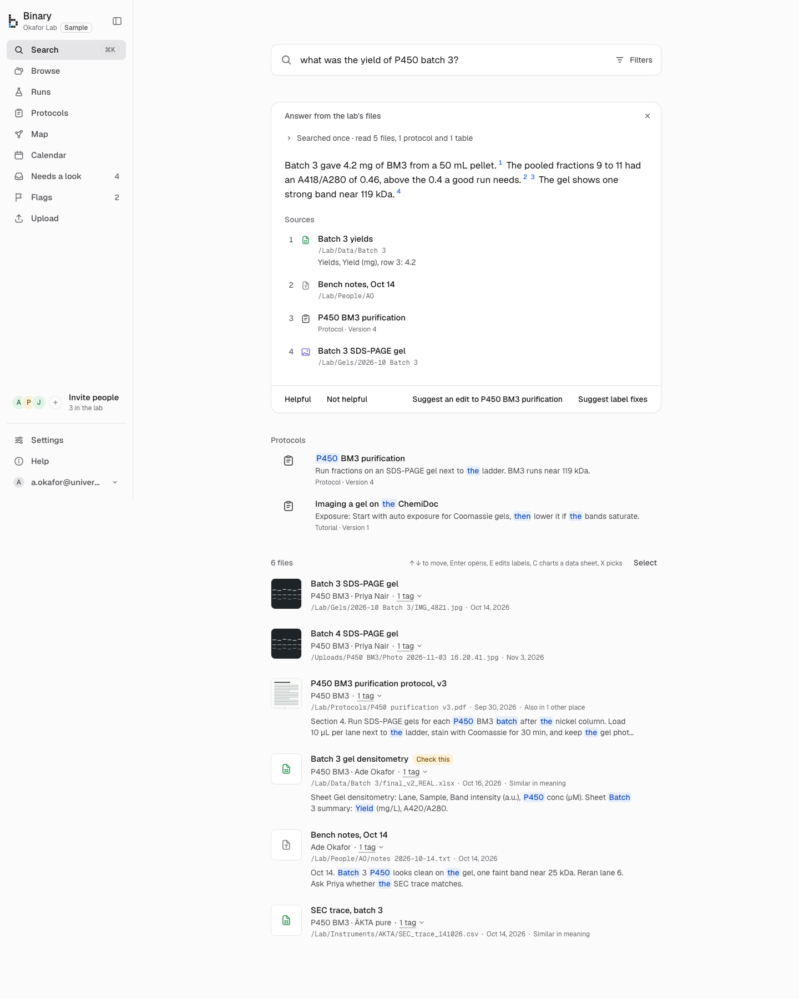

# Binary

Binary is a memory for research labs. It reads a lab's Dropbox, gives every file a clean name and a label, and lets anyone in the lab find what they need by asking in plain words.



<sub>A sample lab. Every name and number in it is made up.</sub>

## What it does

- **Search and ask.** Type "what was the yield of P450 batch 3?" and get an answer built only from the lab's own files, with each claim linked to the file it came from.
- **Labels every file.** Date, experiment, person, instrument and outcome, suggested by Binary and corrected by people.
- **Keeps protocols in one place.** Versions, talk-throughs recorded at the bench, and steps drafted from a procedure video.
- **Checks results as they arrive.** A protocol can say what a good run looks like, such as an R² of at least 0.98. A file outside that range raises a flag.
- **Charts without a stats course.** A chart builder for a first-year student, with dose-response curves, standard curves and the right test.
- **Also:** a map of how the lab's work connects, a shared calendar for instruments, and a drive with every file's version history.

Binary never writes to the lab's Dropbox. It reads, and keeps its own copy.

## How it's built

| Part | What it is |
| --- | --- |
| `apps/web` | The app. Next.js 16 and React, with Supabase for sign-in and data. |
| `apps/landing` | The landing page at [binaryhq.vercel.app](https://binaryhq.vercel.app). |
| `workers` | The Python worker. It scans, reads, labels and embeds files, runs checks, and serves the embedding model. |
| `db/migrations` | The database schema, one numbered SQL file per change. |
| `instruments/uploader` | A small Rust app that sends files from an instrument PC to the lab. |
| `docs` | What we're building and why. |

## Run it locally

You need Node 22 with pnpm, [uv](https://docs.astral.sh/uv/), and Postgres 17 (`brew install postgresql@17`).

1. Copy the settings and link them where each part reads them:

   ```sh
   cp .env.example .env
   ln -s ../../.env apps/web/.env.local
   ln -s ../.env workers/.env
   ```

2. Set up the database and the worker:

   ```sh
   cd workers
   uv sync
   uv run bl migrate
   ```

3. Start each part in its own terminal:

   ```sh
   cd apps/web && pnpm install && pnpm dev     # the app on localhost:3000
   cd workers && uv run bl worker              # scans, labels and checks
   cd workers && uv run bl serve-embed         # the search model on :8787
   ```

To try it without a real lab, `uv run bl demo-lab --admin-email you@example.com` fills a sample lab for your account. Set `EMBED_MODEL=hash-1024` to skip the 1.2 GB model download.

## Tests

```sh
cd apps/web && pnpm test                                  # unit tests
cd apps/web && BL_WEB_TEST_DB=bl_test pnpm test:db        # database tests, on local Postgres
cd workers && BL_TEST_DB=bl_test uv run pytest            # the worker
```

The database tests create and drop their own database, so give each checkout its own name.

## Read more

- [`docs/prd.md`](docs/prd.md) says what Binary is for and who it's for.
- [`docs/decisions.md`](docs/decisions.md) records every choice made while building it, and wins where the two differ.
- [`docs/design.md`](docs/design.md) describes the data shapes.
- [`docs/deploy.md`](docs/deploy.md) has the steps to put it online.
- [`workers/README.md`](workers/README.md) lists every worker command.
